**Full-stack developer · enterprise ERP by day, tailor-made software for my own needs and small businesses on the side**

PHP · Laravel · Swift · React · Docker

---

## 🏭 Day job: automotive ERP

> A large-scale **ERP for the automotive sector**, used by roughly **600 people every day**.

It brings the daily operation of a dealership and workshop into a single system:

| Area | What it does |
|---|---|
| 📅 **Planner & agenda** | Calendar-based scheduling of jobs and technicians, appointment booking and alerts for visits that did not happen |
| 🔧 **Repair orders** | Open, track and close jobs, with labour lines, parts and warranty handling |
| 🧾 **Quotes & invoicing** | Quotes with line items, invoices, invoice history, cash and settled-payment flows |
| 📦 **Parts & stock** | Stock control, goods reception, purchasing and price-list imports |
| 👥 **Customers & vehicles** | Customer and vehicle records shared across every area |
| 📁 **Document management** | Attach, store and retrieve the documents tied to each job |
| 📊 **Reporting** | Lists, exports and generated PDF and Excel documents |
| 🔌 **Integrations** | Connected to manufacturer and accounting systems |

Proprietary company software, so there is no public repository.

---

## 🌐 Portfolio

### [Personal Portfolio](https://juansuarezdev.github.io/personal-portfolio/)
Bilingual (EN/ES) portfolio with an interactive CV that exports to PDF, interactive demos of selected projects, and light and dark themes. [Source code](https://github.com/juansuarezdev/personal-portfolio).

`Astro` `TypeScript` `CSS`

---

## 🚀 Open source and side projects

<table>
<tr>
<td width="33%" valign="top">

### 🌙 [Non-Sleep](https://github.com/juansuarezdev/non-sleep)
Keep your Mac awake **with an end time**. A menu bar app that stops by itself when time is up, the battery is low or the Mac runs hot.

`Swift 6` `SwiftUI` `IOKit` · MIT

</td>
<td width="33%" valign="top">

### 🦷 [Beast](https://github.com/juansuarezdev/beast)
Self-hosted gym and body-weight tracker. Adds **Apple Health sync**, **Live Activities** and **strength progression** on top of openGym.

`React` `Node` `Capacitor` `Swift` · AGPL-3.0

</td>
<td width="33%" valign="top">

### 🏋️ [hevy.routines](https://github.com/juansuarezdev/hevy.routines)
Script that pushes training routines to the **Hevy** app through its API, so a plan lives in a file instead of a phone.

`Python` `REST API`

</td>
</tr>
<tr>
<td width="33%" valign="top">

### 🪟 [Ultrawrail](https://github.com/juansuarezdev/ultrawrail)
Scrolling window manager for macOS, built for **ultrawide monitors**. Windows sit in columns on a horizontal strip, with pages, zones and layout templates.

`Swift 6` `AppKit` `Accessibility API` · MIT

</td>
</tr>
</table>

---

## 🧰 Toolbox

| Area | Stack |
|---|---|
| **Backend** |     |
| **Frontend** |    |
| **Apple platforms** |    |
| **Data & infra** |     |

---

## 🎯 What I care about

- **Software that survives daily use.** Queues, retries, observability and boring reliability over clever code.
- **Owning my own data.** I self-host what I can and build tools that keep working offline.
- **Solving the real problem.** Software built around how a person or a small business actually works, not the other way round.
