**Full-stack & AI engineer.** Laravel back ends for an enterprise automotive ERP by day; AI agent tooling and native Apple apps on the side.

PHP · Laravel · Python · TypeScript · Swift · Claude Code · MCP

🇪🇸 Desarrollador full-stack e IA. [CV en español](https://juansuarezdev.github.io/personal-portfolio/es/cv/).

---

## Featured projects

### [TaskView AI Orchestrator](https://github.com/juansuarezdev/taskview-ai-orchestrator)

Turns a self-hosted kanban board into a work queue for AI coding agents. Assign a card to Claude Code or OpenCode, add a tag, and the orchestrator plans or implements it in its own git worktree, runs an automatic review with a JSON-schema verdict and merges approved work to `main` on opt-in repos.

- Scheduler that paces itself against the model's 5-hour and weekly usage limits, with a fallback chain (Claude, OpenCode, reserve model) and alerts when it degrades
- Sandboxed sessions: per-card branch and worktree, command allow and deny lists, never `--force`; agents ask questions on the card instead of guessing
- Local web panel (queue, runs with cost and duration, settings), GitHub issue sync, daily digests, health checks and verified database backups

`Python (stdlib only)` `launchd` `Claude Code` `OpenCode` `git worktrees` · MIT

<table>
<tr>
<td width="96" valign="top"></td>
<td valign="top">

### NOVA · private

Native, local-first replacement for Apple Reminders on macOS and iPhone, built from a written PRD, a competitive research report and 14 architecture decision records.

- Offline bilingual (EN/ES) natural-language capture: `Pay electricity Friday at 9 #home !!`
- Shared Swift package (`NovaCore`): data model on GRDB/SQLite, NL parser, recurrence engine, notification planner that respects iOS limits, hybrid-logical-clock sync over your own network
- Widgets, location triggers, Reminders import, undo, backups and a recovery bin; ~14k lines of Swift with 260+ tests

`Swift 6` `SwiftUI` `GRDB` `SQLite` `WidgetKit` `XcodeGen`

</td>
</tr>
</table>

### [Beast](https://github.com/juansuarezdev/beast)

Self-hosted gym and body-weight tracker for iPhone, built on top of openGym. I added the native iOS layer and the training logic:

- **Apple Health sync** through a custom Capacitor plugin and a **Live Activity** that keeps the running workout on the lock screen
- **Strength progression**: RPE-based progression, top set plus back-off sets, rep records and live comparison with the last session
- Cardio by sport, weekly goals, passkey login and multi-device sync on your own server

`React` `Node` `Capacitor` `Swift` `ActivityKit` `HealthKit` · AGPL-3.0

---

## More work

| Project | What it is | Stack |
|---|---|---|
| [Ultrawrail](https://github.com/juansuarezdev/ultrawrail) | Scrolling window manager for ultrawide monitors: columns on a horizontal strip, pages, zones and layout templates | Swift 6 · AppKit · Accessibility API |
| [Non-Sleep](https://github.com/juansuarezdev/non-sleep) | Menu bar app that keeps the Mac awake until a set time, low battery or high temperature | Swift 6 · SwiftUI · IOKit |
| [Personal Portfolio](https://github.com/juansuarezdev/personal-portfolio) | Bilingual portfolio with an interactive CV that exports to PDF | Astro · TypeScript |
| [hevy.routines](https://github.com/juansuarezdev/hevy.routines) | Pushes training routines to the Hevy app through its API | Python |
| local-delegate private | MCP server that hands short, verifiable tasks to a local LLM so file contents never enter the main agent's context | Python · MCP · Ollama |
| gitpilot private | CLI where an LLM proposes a diff that git and the test suite validate before it is applied, with every change recorded | Python · Typer · SQLite |
| Brain Monitor private | Real-time dashboard of which AI agent reads or writes each note of a knowledge base, with SSE streams, alerts and a 3D graph | TypeScript · Fastify · Vue 3 |
| Vida OS private | Local personal dashboard: calendar, tasks, document search with cited answers and a nightly review agent | TypeScript |

## Day job: automotive ERP

Back-end developer on a large **ERP for the automotive sector** used by about **600 people every day**: repair orders, scheduling, quotes and invoicing, parts and stock, document management, reporting, and integrations with manufacturer and accounting systems. Laravel, queues (Redis, Horizon), MySQL. Proprietary software, no public repository.

## Toolbox

| Area | Stack |
|---|---|
| **Backend** |     |
| **Frontend** |    |
| **Apple platforms** |    |
| **AI & agents** |    |
| **Data & infra** |      |

## How I work

- **Agents as teammates, with guardrails.** Isolated branches, automatic review and a human decision before anything reaches `main`.
- **Software that survives daily use.** Queues, retries, tests and boring reliability over clever code.
- **Local-first.** I self-host what I can and build tools that keep working offline.
